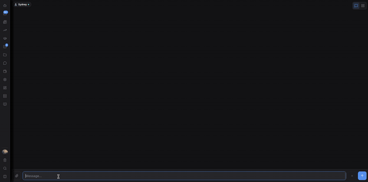
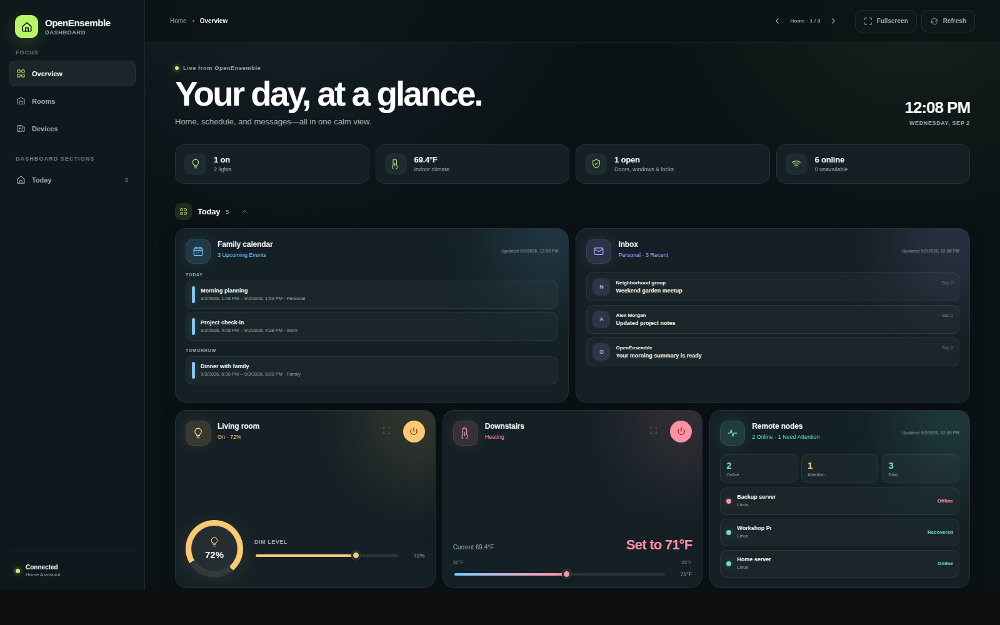

# OpenEnsemble

A self-hosted AI assistant with your choice of local or cloud models. Start
with one assistant, then add specialist agents, connected services, dashboards,
or open-hardware voice devices. Each user has their own workspace.

## Get your first reply

On Linux, with Git installed:

```bash
git clone --depth 1 https://github.com/openensemble/openensemble.git
cd openensemble
./install.sh
```

1. Keep the one-time first-run credential printed by the installer.
2. Open `https://<your-server-ip>:3739`. Check that it is your server before
   accepting the installer's self-signed certificate warning.
3. Create the owner account, or restore a backup, using that credential.
4. Open **Settings → Providers**, connect one chat provider, and enable it.
5. Choose **Create Your Assistant**, pick its model, save, and send a greeting.

New accounts use **Single assistant** mode. To add specialists later, switch
**Settings → Agents → Agent setup** to **Agent ensemble**. Cortex provides
internal reasoning and retrieval; your assistant still needs a chat provider.

**Requirements:** Linux (Debian-family systems are the main install path),
Node.js **22.12 or newer**, and the build/media/sandbox tools checked by the
installer. macOS is a local-development option with different feature support.
The installer can install missing dependencies and a systemd user service.
It prepares Python virtual-environment support for optional voice engines and,
on Debian-family systems, the SMB/NFS share clients. Voice engines and their
models install when selected. Code-project ZIP downloads support Python 3.7+.
OE can check and repair network-share/FUSE setup through its administrator
tools, including paired Docker Compose and Proxmox container hosts.
Shallow clones support normal in-app updates.

[Installation and Docker](docs/getting-started.md) ·
[First-run walkthrough](guide/getting-started.md) ·
[Complete user guide](https://openensemble.github.io/openensemble/guide/) ·
[Troubleshooting](guide/troubleshooting.md)

Run `oe bootstrap` on the server if you lose the credential before setup is
complete. HTTP localhost on port 3737 is also available from a browser running
on the OE host; remote first-run setup uses HTTPS.



## What you can add

| Goal | Read next |
|---|---|
| Use one assistant or specialists with different models | [Single assistant and ensembles](guide/single-assistant.md), [Providers](guide/providers.md) |
| Keep separate chats and ongoing projects | [Saved chats](guide/saved-chats.md), [Project spaces](guide/project-spaces.md) |
| Connect mail and Google Calendar | [Email & calendar](guide/email-calendar.md) |
| Control home devices and saved action sequences | [Home Assistant](guide/home-assistant.md), [Routines](guide/routines.md) |
| Schedule work, reminders, and monitoring | [Tasks & scheduler](guide/tasks.md) |
| Work with files, media, research, and code projects | [Documents & sharing](guide/documents.md) |
| Create skills and connect external tools | [Skill Builder](guide/skill-builder.md), [MCP](guide/mcp.md) |
| Manage a remote machine and its services | [Nodes](guide/nodes.md), [Service profiles](guide/services.md) |
| Learn preferences and prepare useful drafts | [Personalization](guide/personalization.md) |
| Inspect background work and recover a job | [Run Inspector](guide/run-inspector.md), [Resumable jobs](guide/resumable-jobs.md) |

## Display dashboards

Build up to 32 dashboards per profile, each with a stable address. Combine Home
Assistant controls, calendar, email, node status, and custom-skill widgets.
Customize portrait and landscape layouts, colors, and page elements; swipe
between displays on a tablet.



Dashboard addresses use the signed-in profile and require normal OE login.
Use a dedicated profile with limited access for an unattended display.
[Dashboard guide](guide/dashboards.md).

## Voice devices (beta)

Pair a **Seeed reSpeaker XVF3800 + XIAO ESP32-S3**, say “Hey Ensemble,” and talk
to your assistant. The browser flash wizard uses Chrome or Edge; prebuilt
firmware is included. Supported features include household wake-word routing,
conversation mode, AirPlay, and device-side alarms.

Voice processing follows your provider choices: remote STT receives recordings,
cloud chat receives transcript/context, and remote TTS receives reply text.
Configure local STT, chat, and TTS for local voice processing, and check other
integrations separately. [Voice setup](guide/voice-devices.md) ·
[Model and privacy choices](guide/models-explained.md) ·
[Open firmware](https://github.com/openensemble/voice-device-firmware).

## Run and maintain your server

- [Back up, restore, and update](guide/backup-update.md). Backups contain account
  data, saved configuration, custom content, and decryption keys; they exclude
  dependencies and bundled models. Password-protected exports use `.oeb`.
- [Manage users and access](guide/users.md).
- [Set up public or private access](guide/public-access.md) with Cloudflare,
  a reverse proxy, or Tailscale.
- [Understand security](guide/security.md). Browser sessions use HttpOnly
  cookies; non-browser clients can use bearer tokens.
- [Configure optional wake verification](guide/voice-verification.md).
- [See added features and release history](guide/whats-new.md).

For development, `npm ci --ignore-scripts` installs dependencies without the
model download; `npm start` uses the launcher. Local tests belong in ignored
`tests/`. Follow [AGENTS.md](AGENTS.md) and
[documentation maintenance](docs/development/documentation.md) when contributing.

## License

[GNU Affero General Public License v3.0 or later](https://www.gnu.org/licenses/agpl-3.0.html). In plain English:

- **Allowed:** running OpenEnsemble yourself or for any commercial purpose, modifying it, redistributing it, and offering it as a hosted service.
- **Required:** if you modify OpenEnsemble and let anyone else use it (including over a network — hosting it for users counts), you must offer them the source of your modifications under the same AGPL-3.0 license.
- **Required:** preserve the copyright and license notices.

See `LICENSE` for the full text. For organizations that want to embed OpenEnsemble without the AGPL's copyleft obligation, a separate commercial license is available — get in touch.
